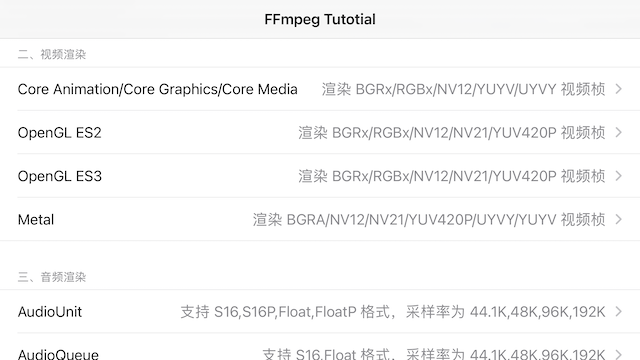
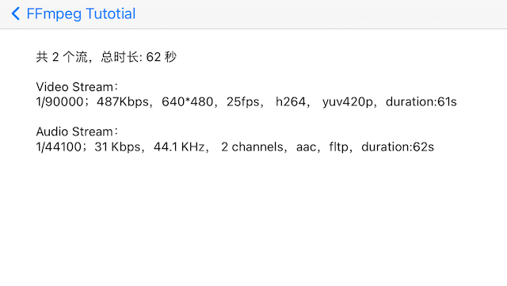
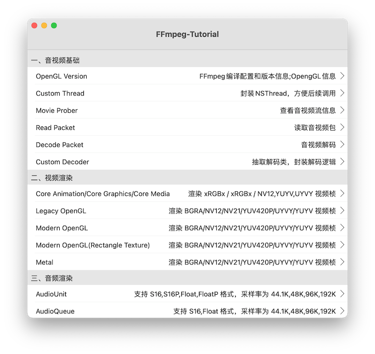
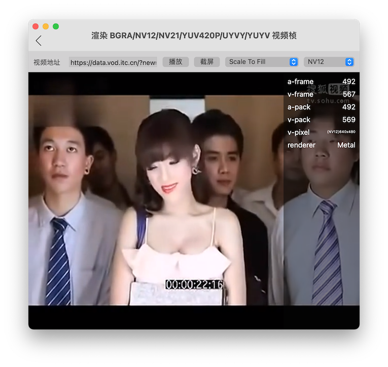
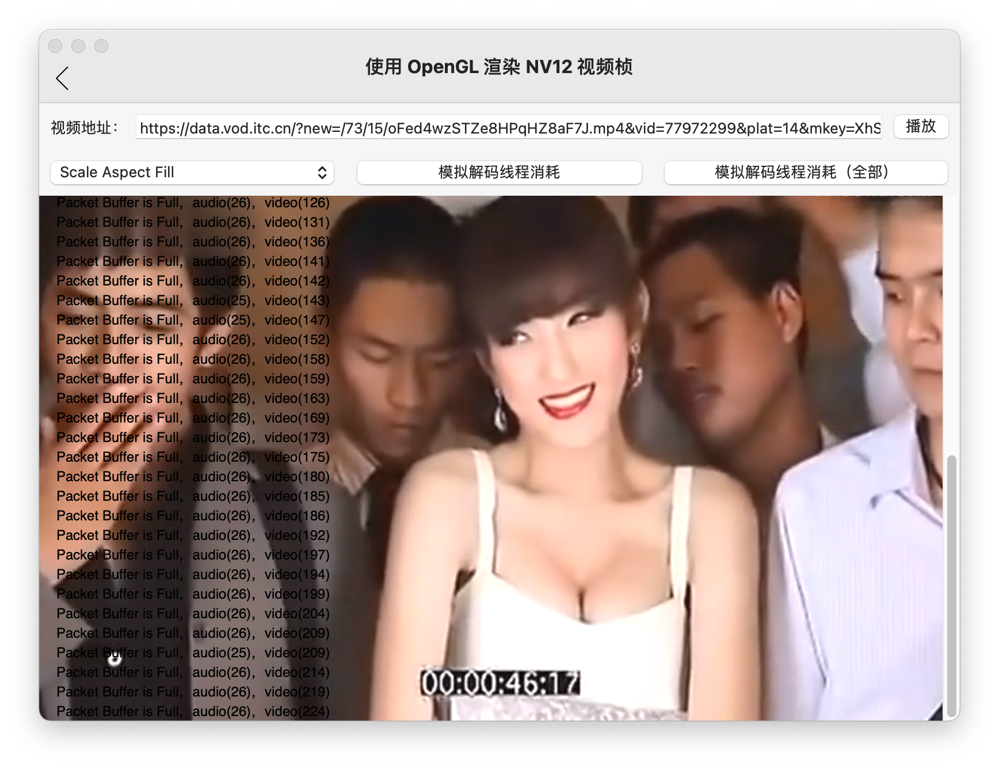

[](https://ffmpeg.org/) 

> 帮助零基础的 iOS/macOS 开发人员快速学习基于 FFmpeg 的音视频技术，主要包括了在 iOS/macOS 平台如何调用 FFmpeg 以及多种音视频渲染技术的对比。 
> 
> 感觉有用的话给个 Star 吧😊

[](https://github.com/debugly/FFmpegTutorial/stargazers)

## iOS 示例工程:

```bash
git clone https://github.com/debugly/FFmpegTutorial.git
cd FFmpegTutorial
#下载预编译好的 FFmpeg 静态库
./install-pre-any.sh ios
open Example/iOS/iOSExample.xcworkspace
```

运行效果:





## macOS 示例工程:

```bash
git clone https://github.com/debugly/FFmpegTutorial.git
cd FFmpegTutorial
#下载预编译好的 FFmpeg 静态库
./install-pre-any.sh macos
open Example/macOS/macOSExample.xcworkspace
```








## 简介

教程共分为六个部分，提供了 iOS 和 macOS 的上层调用示例，使用 Objective-C 语言开发:

一、音视频基础

- OpenGL Version: 查看编译FFmpeg时的配置信息、支持的协议、版本号以及 OpengGL 信息
- Custom Thread: 封装 NSThread，方便后续调用
- Movie Prober: 查看音视频流信息
- Read Packet: 读取音视频包
- Decode Packet: 音视频解码
- Custom Decoder: 抽取解码类，封装解码逻辑

二、视频渲染

- Core API: 使用 Core Graphics/Core Image/Core Media 渲染视频帧
- Legacy OpenGL/OpenGL ES2: 渲染 BGRA/NV12/NV21/YUV420P/UYVY/YUYV 视频桢
- Modern OpenGL/OpenGL ES3: 渲染 BGRA/NV12/NV21/YUV420P/UYVY/YUYV 视频桢
- Modern OpenGL(Rectangle Texture): 渲染 BGRA/NV12/NV21/YUV420P/UYVY/YUYV 视频桢
- Metal: 渲染 BGRA/NV12/NV21/YUV420P/UYVY/YUYV 视频桢

三、音频渲染

- AudioUnit: 支持 S16,S16P,Float,FloatP 格式，采样率支持 44.1K,48K,96K,192K
- AudioQueue: 支持 S16,Float格式，采样率支持 44.1K,48K,96K,192K
- 封装 AudioUnit 和 AudioQueue 渲染逻辑，调用者无需感知

四、封装播放器

- VideoFrameQueue: 增加 VideoFrame 缓存队列，不再阻塞解码线程
- PacketQueue: 增加 AVPacket 缓存队列，创建解码线程
- VideoRendering Embed: 创建视频渲染线程，将视频相关逻辑封装到播放器内
- AudioRendering Embed: 将音频相关逻辑封装到播放器内
- Show Play Progress: 显示音视频播放进度
- Sync Audio And Video: 音视频同步

五、趣味实验

- 黑白电视机雪花屏、灰色色阶图、三个小球

六、跨平台播放器

- 参考 [fsplayer](https://github.com/debugly/fsplayer)

七、编译 FFmpeg

- 参考 [MRFFToolChainBuildShell](https://github.com/debugly/MRFFToolChainBuildShell)

## 捐赠

编写本教程花费了本人大量的时间，希望能够为新人学习音视频渲染提供一些帮助，请买杯咖啡给我提提神儿。


